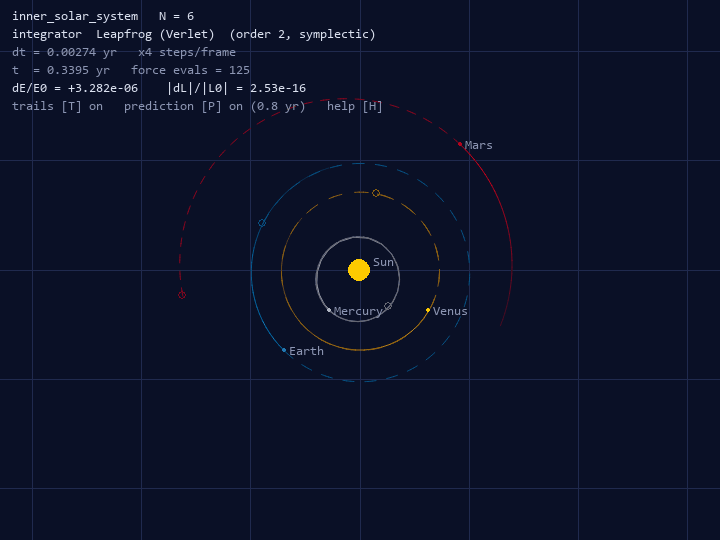
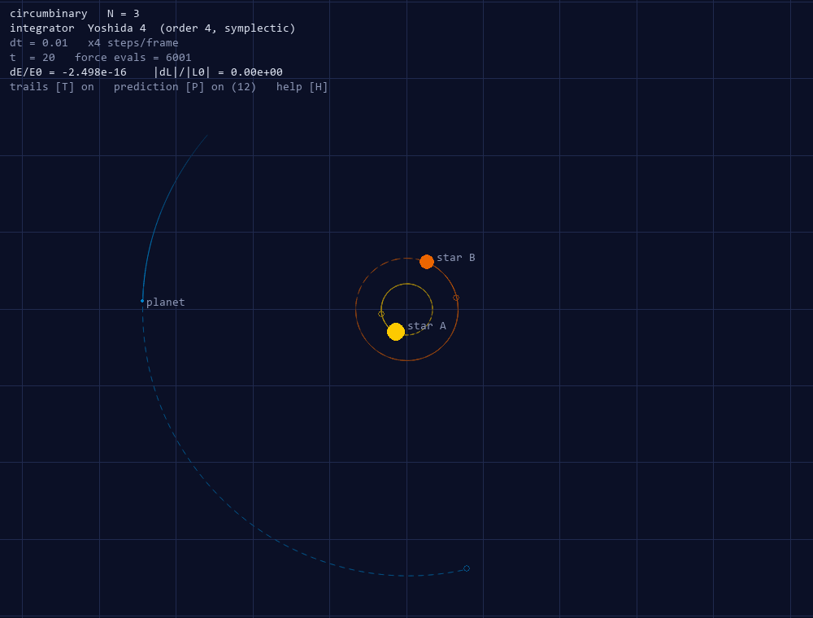

# Structure-Preserving Integration of the Gravitational N-Body Problem

A computational-physics project on the numerical integration of Newtonian gravity:
from explicit Euler to sixth-order symplectic composition methods and adaptive
Runge–Kutta pairs. It combines a written thesis (Typst, TU Darmstadt template)
with a tested Python package (`nbody`) and a reproducible evaluation pipeline.

> Revised and extended version of a group project of the course *Computerphysik*
> (TU Darmstadt, winter term 2024/25) by Chahid El Aaouadi, Eren Can and Simon Pfeiffer.
> Original code: <https://github.com/erencan-02/Computerphysik-Python>

📄 **Thesis:** [`thesis/thesis.pdf`](thesis/thesis.pdf) (background, theory with derivations,
implementation, evaluation, outlook)

## Highlights

| | |
|---|---|
| **Integrators** | explicit Euler · symplectic Euler · Heun · leapfrog/Verlet · RK4 · Yoshida 4 · Yoshida 6 (triple jump and 7-stage "solution A") · adaptive Dormand–Prince 5(4) |
| **Theory → tests** | every claimed property (order, symplecticity, time-reversibility, cost) is checked by an automated test (100 tests) |
| **Measured orders** | agree with theory to within 0.3 for all eight fixed-step methods |
| **Long-term behaviour** | symplectic methods: bounded energy error, global error ∝ t; RK4/DOPRI5: energy drift, error ∝ t² (measured exponents 1.00 vs. 1.94–1.98) |
| **Solar System** | 1000 years, one force evaluation per day: relative energy error < 3·10⁻⁶ (leapfrog / Yoshida 4) |
| **Chaos** | Pythagorean three-body problem: step sizes over 6 orders of magnitude; the outcome (which body escapes) is only reproducible for tolerances ≤ 10⁻¹¹ |
| **Performance** | vectorised force kernels ~180–215× faster than the original pair loop (N = 128–512) |
| **Visualisation** | real-time viewer with trajectory overlays: fading trails (past) and a forecast obtained by integrating a ghost copy of the system (future) |

<p align="center">
  
  
</p>

## Repository layout

```text
├── src/nbody/              Python package
│   ├── core/               State (structure of arrays), force models, force kernels
│   ├── integrators/        Euler, Verlet, Runge-Kutta, composition, adaptive + registry
│   ├── analysis/           conserved quantities, evaluation metrics, exact Kepler solution
│   ├── scenarios/          builtin initial conditions, JSON scenario format
│   ├── viz/                plot style, static plots, real-time viewer, trajectory overlays
│   ├── simulation.py       simulation driver, Trajectory container (.npz)
│   └── cli.py              command-line interface (python -m nbody)
├── scenarios/              user-editable JSON scenarios (incl. those of the original project)
├── experiments/            evaluation experiments e01–e09 and run_all.py
├── tests/                  pytest suite
├── scripts/                fetch_fonts.py (thesis fonts), make_readme_gif.py (animation below)
├── docs/showcase.gif       README animation (leapfrog, 4 simulated days per frame)
└── thesis/                 Typst sources of the thesis
    ├── main.typ            template configuration (dark-blue TU Darmstadt theme)
    ├── chapters/           introduction, physics, numerics, implementation, evaluation, ...
    ├── lib/utils.typ       number formatting, data-driven tables, callouts
    ├── figures/generated/  figures written by the experiments
    ├── data/               CSV/JSON results read directly by the thesis
    └── references.bib
```

## Quick start

```bash
pip install -e ".[viewer,experiments,dev]"
python -m pytest                      # 100 tests, ~30 s

python -m nbody list                  # scenarios and integrators
python -m nbody view solar_system     # interactive viewer (H shows the key bindings)
python -m nbody compare kepler -i euler leapfrog rk4 yoshida4 --t-end 200
python -m nbody simulate pythagorean --rtol 1e-11 --plot
```

Without installing, prefix commands with `PYTHONPATH=src` (Windows PowerShell: `$env:PYTHONPATH="src"`).

Python API:

```python
from nbody import load_scenario, simulate
from nbody.analysis import conservation_report

sc = load_scenario("kepler", e=0.6)
traj = simulate(sc.model(), sc.initial_state(), "yoshida4", t_end=100.0, dt=0.01)
print(conservation_report(traj))
```

Adding an integrator does not require touching existing code, e.g. Suzuki's 5-stage
fourth-order composition:

```python
from nbody.integrators import Composition, VelocityVerlet, register

s = 1 / (4 - 4 ** (1 / 3))
register("suzuki4", lambda: Composition(VelocityVerlet(), [s, s, 1 - 4 * s, s, s],
                                        order=4, name="suzuki4", label="Suzuki 4"))
```

## Reproducing the thesis

```bash
python -m experiments.run_all                 # all experiments (~6 min) -> thesis/figures, thesis/data
python scripts/fetch_fonts.py                 # Roboto + XCharter from CTAN (needed by the template)
typst compile thesis/main.typ thesis/thesis.pdf --font-path thesis/assets/fonts
```

The thesis uses the TU Darmstadt template
[`@preview/athena-tu-darmstadt-thesis`](https://typst.app/universe/package/athena-tu-darmstadt-thesis)
with the accent colour `1d` (dark blue). Typst downloads the package automatically.
The official TU Darmstadt logo is only available to members of the university; the title page
therefore shows a project emblem. To use the official logo, place `tuda_logo.svg` in
`thesis/assets/logos/` and change `logo_tuda` in `thesis/main.typ`.

Experiments can be run individually, e.g. `python -m experiments.run_all e02 e06`.
All numerical results are deterministic; only wall-clock timings depend on the machine.
